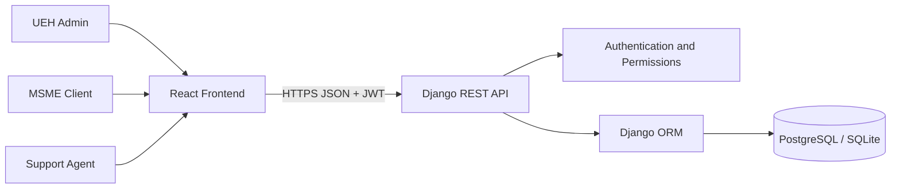

# Architecture
- React + Vite single-page frontend.
- Django REST Framework API.
- Django ORM with SQLite locally and PostgreSQL for shared deployment.
- JWT authentication and role-based API permissions.

## Main flows
1. Client registers and signs in; backend stores a salted password hash.
2. Client submits a support request; API validates fields and stores it with status OPEN.
3. Agent views assigned requests and updates status.
4. Admin publishes opportunities and reviews client applications.
5. Dashboard endpoint aggregates request and application counts.
