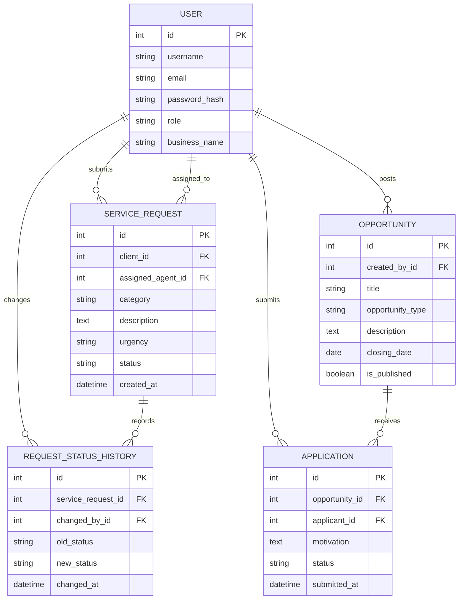

# Entity Relationship Diagram

The business data model has five related tables: User, ServiceRequest, RequestStatusHistory, Opportunity and Application. RequestStatusHistory records who changed a request status and when, providing an audit trail.
